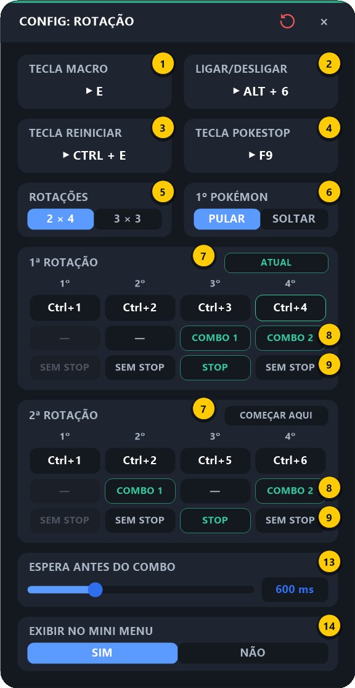
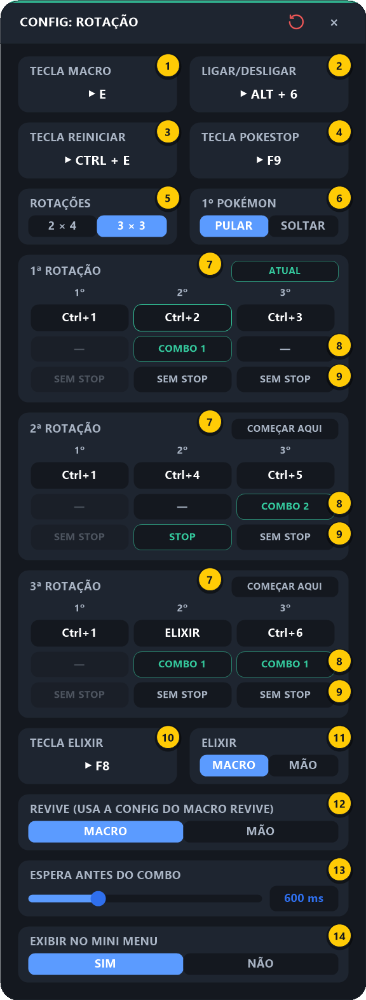
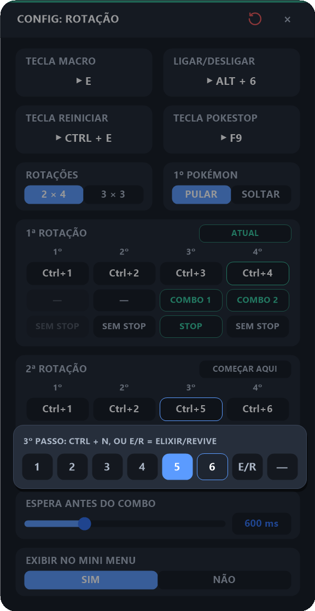
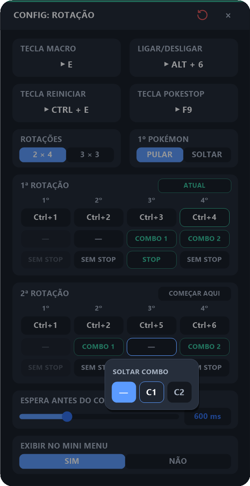
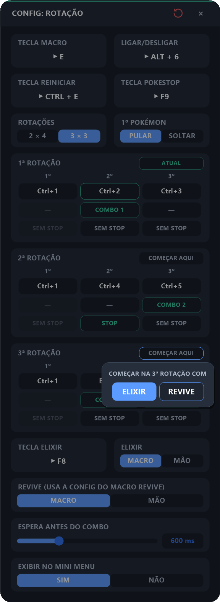

# 6. Rotação

[⬅ Cooldown](05-cooldown.md) · [README](../README.md) · Próximo: [Configurações Gerais ➡](07-configuracoes-gerais.md)

A Rotação troca de pokémon com **uma tecla só**: cada vez que você aperta a **Tecla Macro**, ela envia o `Ctrl + N` do pokémon da vez e já passa para o próximo da ordem que você salvou. Se quiser, ela também **solta o Combo 1 ou o Combo 2 logo depois da troca** e **aperta a tecla Pokestop assim que o pokémon sai** — você escolhe, passo por passo, em quais trocas cada coisa acontece. A HUD mostra, no próprio ícone, **qual `Ctrl + N` sai no próximo aperto**.

---

## 6.1 O que ele faz, na ordem

A ordem é uma rotação depois da outra e, no fim da última, volta ao começo. Há dois **formatos**:

| Formato | Para quando | Padrão |
|---------|-------------|--------|
| **2 × 4** — 2 rotações de 4 pokémons | Começo do jogo | `1-2-3-4` · `1-2-5-6` |
| **3 × 3** — 3 rotações de 3 pokémons | Mais para frente, com o time mais forte | `1-2-3` · `1-4-5` · `1-—-6` |

Cada formato guarda a **sua própria** configuração: trocar de 2 × 4 para 3 × 3 e voltar não perde nada.

- **Cada aperto envia um `Ctrl + N` só** — quem decide a hora de trocar é você.
- **Cada aperto também para o combo que estiver rodando** (Combo Principal, Secundário, Combo Revive ou o combo pós-troca de um aperto anterior). Assim as skills que faltavam — e o Full Defense — não saem no pokémon que acabou de entrar.
- **Combo depois da troca (opcional, por passo).** Embaixo de cada passo há uma opção: `—` (só troca, padrão), `COMBO 1` ou `COMBO 2`. Com um combo marcado, depois de enviar o `Ctrl + N` o macro espera a **Espera antes do combo** (o tempo do pokémon sair da pokébola) e solta o combo — veja [6.4](#64-combo-depois-da-troca).
- **Pokestop depois da troca (opcional, por passo).** Na última linha de cada passo há `STOP` / `SEM STOP`. Com `STOP`, logo depois do `Ctrl + N` o macro aperta a **Tecla Pokestop** — antes do combo, se houver — veja [6.5](#65-pokestop-depois-da-troca).
- **Elixir / Revive (opcional, passo `E/R`).** Um passo pode ser `E/R` em vez de um pokémon: ele alterna, a cada volta, entre o **Elixir de Ataque** e o **Revive** no pokémon de antes dele — veja [6.6](#66-elixir--revive-passo-er).
- Um passo **vazio (`—`)** é pulado. Ex.: no 2 × 4, deixando o 4º passo da 2ª rotação vazio, a ordem vira `1-2-3-4 | 1-2-5` e volta para o começo.
- **Ligar a Rotação** (na HUD ou pelo atalho) sempre começa do início.
- **O 1º pokémon de cada rotação fica com você (padrão).** Com a opção **1º Pokémon** em `PULAR`, o macro **nunca envia o 1º passo de nenhuma rotação**: você puxa esse pokémon à mão no começo de cada rotação, e o macro só chama do 2º em diante. Para o macro enviar o 1º passo também, mude a opção para `SOLTAR`.
- A posição atual fica só na memória: ao reiniciar o programa, a rotação recomeça do início.

Com o padrão (`PULAR`), os apertos da Tecla Macro enviam:

```
2 × 4:  (1 à mão) 2 → 3 → 4   (1 à mão) 2 → 5 → 6   → volta para o 2
3 × 3:  (1 à mão) 2 → 3   (1 à mão) 4 → 5   (1 à mão) 6   → volta para o 2
```

### A 3ª rotação do 3 × 3 (pokémon repetido)

Na 3ª rotação do 3 × 3 é comum **repetir um pokémon** antes do último. Para isso serve o **2º passo da 3ª rotação**:

- **Vazio (`—`, padrão):** depois do 1º pokémon, o macro vai **direto para o 3º** (`Ctrl+6`).
- **Com um `Ctrl + N`:** o macro solta esse pokémon repetido e só então o 3º. Ex.: com `Ctrl+4` ali, a 3ª rotação fica `(1 à mão) 4 → 6`.
- **Com `E/R`:** em vez de outro pokémon, o 1º recebe o **Elixir de Ataque** (numa volta) ou o **Revive** (na seguinte) antes do `Ctrl+6` — veja [6.6](#66-elixir--revive-passo-er).

É o mesmo `—` de qualquer outro passo: clique no botão e escolha `—` para desativar, ou o número desejado (ou `E/R`) para ativar.

---

## 6.2 Configurando

Passe o mouse na HUD e clique no **⚙ abaixo do ícone da Rotação** (o 6º, duas pokébolas com setas verdes):

| 2 × 4 | 3 × 3 |
|:---:|:---:|
|  |  |

| # | Campo | O que configurar |
|:-:|-------|------------------|
| **1** | **Tecla Macro** | A tecla que envia o próximo pokémon da rotação |
| **2** | **Ligar/Desligar** | Atalho para ligar/desligar a Rotação sem abrir a HUD |
| **3** | **Tecla Reiniciar** | Atalho que volta a rotação para o **início** (só funciona com a Rotação ligada) |
| **4** | **Tecla Pokestop** | A tecla de Pokestop do jogo, apertada nos passos com `STOP` (9). É a mesma tecla das [Configurações Gerais](07-configuracoes-gerais.md#passo-7--tecla-pokestop): mudar aqui muda lá |
| **5** | **Rotações** | Formato: `2 × 4` (2 rotações de 4 pokémons) ou `3 × 3` (3 rotações de 3). A tela se ajusta na hora, com um cartão por rotação |
| **6** | **1º Pokémon** | `PULAR` (padrão): o macro nunca envia o 1º passo das rotações — você puxa esse pokémon à mão. `SOLTAR`: o 1º passo sai normalmente |
| **7** | **Rotações (cartões)** | Um cartão por rotação, com um botão por passo. Clicar num passo abre o seletor para escolher o pokémon (`1` a `6`), `E/R` (elixir/revive — do 2º passo em diante; o botão mostra `ELIXIR` ou `REVIVE`, o que sai nesta volta) ou `—` (vazio). No canto de cada cartão, **`ATUAL`** marca a rotação do próximo aperto; nas outras, **`COMEÇAR AQUI`** leva a Rotação para o começo daquela rotação — veja [6.3](#63-usando-no-jogo) |
| **8** | **Combo depois da troca** | A 2ª linha de cada cartão: o combo que sai logo depois de trocar para aquele passo — `—` (nenhum), `COMBO 1` (Combo Principal) ou `COMBO 2` (Combo Secundário). Fica apagada nos passos que o macro não envia (vazios, ou o 1º com `PULAR`) |
| **9** | **Pokestop** | A última linha de cada cartão: `STOP` aperta a **Tecla Pokestop** logo depois de soltar aquele pokémon (antes do combo); `SEM STOP` (padrão) não aperta. Clique para alternar. Também fica apagada nos passos que o macro não envia |
| **10** | **Tecla Elixir** | *(só aparece com um passo `E/R`)* A hotkey do Elixir de Ataque no jogo. Aceita combinação com **Ctrl/Alt/Shift** e botões do mouse, inclusive o **direito** — ex.: segure `Ctrl` e aperte o botão do mouse para salvar `CTRL + XBUTTON2` (só o clique esquerdo é recusado) |
| **11** | **Elixir** | *(só com `E/R`)* `MACRO` (padrão): o macro usa o elixir nas voltas dele. `MÃO`: você usa à mão e o macro não faz nada nessas voltas |
| **12** | **Revive** | *(só com `E/R`)* `MACRO` (padrão): a Tecla Macro faz o revive nas voltas dele, com **tudo da [tela do Revive](03-revive.md)** (posição, hotkey e delay — configure lá). `MÃO`: você revive à mão e a Tecla Macro vai direto para o próximo pokémon |
| **13** | **Espera antes do combo** | Tempo (0 a 2000 ms, padrão 500) entre a troca e o 1º botão do combo, para o pokémon já estar fora. Só vale nos passos com combo |
| **14** | **Exibir no Mini Menu** | `NÃO` esconde o ícone da Rotação da HUD |

O passo que sai no próximo aperto aparece com contorno verde (nas imagens, o `Ctrl+4` da 1ª rotação no 2 × 4 e o `Ctrl+2` no 3 × 3). Os campos 10 a 12 só aparecem quando algum passo do formato é `E/R` (na imagem do 3 × 3, o 2º passo da 3ª rotação). Com eles, a tela pode ficar mais alta que o monitor — aí ela ganha uma barra de rolagem (role com a roda do mouse; veja [Primeiros Passos](01-primeiros-passos.md#13-anatomia-de-uma-tela-de-configuração)).

### Passo a passo

1. **Tecla Macro** (1): clique no cartão e aperte a tecla que vai trocar de pokémon.
2. **Rotações** (5): escolha `2 × 4` ou `3 × 3`.
3. **Cartões das rotações** (7): clique no botão de um passo — abre, logo abaixo dele, um seletor com as opções `1` a `6` (o `N` do `Ctrl + N`), `E/R` (elixir/revive — não aparece no 1º passo) e `—` (vazio), com a atual destacada em azul. Clique na opção desejada. Clicar fora do seletor ou apertar `Esc` fecha sem mudar nada. Use `—` para pular um passo (ex.: o pokémon repetido da 3ª rotação no 3 × 3).

   <p align="center"></p>

   > Mexer em qualquer passo (ou nas opções 5 e 6) **reinicia** a rotação.
4. **1º Pokémon** (6): deixe em `PULAR` se você puxa o 1º pokémon à mão no começo de cada rotação (o normal). Escolha `SOLTAR` se quiser que o macro chame ele também.
5. *(Opcional)* **Combo depois da troca** (8): clique na 2ª linha de um passo e escolha `—`, `C1` (Combo 1) ou `C2` (Combo 2). Ajuste a **Espera antes do combo** (13) se o combo começar antes do pokémon sair.

   <p align="center"></p>
6. *(Opcional)* **Pokestop** (9): defina a **Tecla Pokestop** (4) e clique na última linha dos passos em que o pokémon deve dar stop ao sair — ela muda de `SEM STOP` para `STOP` (verde). Veja [6.5](#65-pokestop-depois-da-troca).
7. *(Opcional)* **Elixir / Revive**: escolha `E/R` num passo (ex.: o 2º da 3ª rotação no 3 × 3), defina a **Tecla Elixir** (10), escolha `MACRO` ou `MÃO` para o elixir (11) e o revive (12) e confira a posição e a hotkey na tela do Revive (o revive usa as de lá). Veja [6.6](#66-elixir--revive-passo-er).
8. *(Opcional)* **Tecla Reiniciar** (3): útil se, no meio da luta, a ordem real dos pokémons sair do compasso da HUD.
9. Feche no **×**.

---

## 6.3 Usando no jogo

1. Na HUD, clique no ícone da **Rotação** (6º) para ligá-la — o anel fica azul, o ícone escurece e aparece por cima o número do **próximo** `Ctrl + N`:

   <p align="center"></p>

   Na imagem, a Rotação acabou de ser ligada com o padrão (1º pokémon puxado à mão) e o ícone mostra **2**: o próximo aperto envia `Ctrl+2`.
2. Com o jogo em foco, aperte a **Tecla Macro** para soltar o pokémon da vez. O número do ícone muda na hora (**R** quando o próximo aperto é o revive de um passo `E/R`). Se um combo estiver rodando, ele **para** antes da troca.
3. Saiu do compasso? Aperte a **Tecla Reiniciar** — aparece o aviso:

   <p align="center"></p>
4. Fez uma rotação **à mão**, sem a Tecla Macro (ou o macro passou da conta)? Abra a tela da Rotação e clique em **`COMEÇAR AQUI`** no cartão da rotação certa. Ex.: você soltou a 1ª rotação à mão — clique no da 2ª, e o próximo aperto já envia o 1º passo dela (com o padrão `PULAR`, o 2º pokémon da 2ª rotação, porque o 1º você puxa à mão). O cartão passa a mostrar `ATUAL`, o contorno verde vai para o passo novo e a HUD atualiza o número.
   - **Rotação com passo `E/R`:** o `COMEÇAR AQUI` dela abre a escolha **`ELIXIR` / `REVIVE`** — a vez do `E/R` a partir dali. Ex.: começando na 3ª com `ELIXIR`, o elixir já fica pronto para o próximo combo do 1º; com `REVIVE`, o próximo aperto faz o revive. Clicar fora ou `Esc` cancela sem mudar nada.

     <p align="center"></p>
   - Se essa rotação já é a `ATUAL`, o chip dela também abre a escolha e muda **só a vez** (a posição fica onde está) — útil se você usou o elixir ou o revive à mão e a alternância saiu do compasso.
   - Nas rotações sem `E/R`, a vez não muda: ela só troca quando a sequência dá a volta pela Tecla Macro.

> 💡 A Rotação funciona mesmo durante um combo — e **interrompe o combo**, para as skills restantes não saírem no pokémon novo.
>
> 💡 Com a Rotação **desligada**, o ícone volta ao normal (sem número), e a Tecla Macro volta a chegar normalmente ao jogo.

---

## 6.4 Combo depois da troca

Cada passo pode soltar um combo logo depois de trocar de pokémon. Ex.: na imagem do 6.2, a 1ª rotação está `(1 à mão) 2 → 3 + COMBO 1 → 4 + COMBO 2`: o aperto que chama o `Ctrl+2` só troca; o que chama o `Ctrl+3` troca e solta o Combo 1; o do `Ctrl+4` troca e solta o Combo 2.

- **Combo 1** usa a configuração do **Combo Principal** e **Combo 2** a do **Combo Secundário** (botão inicial/final e Full Attack/Defense de cada um — veja [Combos](02-combos.md)), com o **Delay entre teclas** (o mesmo de todos os combos). Não precisa deixar aquele combo ligado na HUD.
- Ordem de cada aperto: para o combo que estiver rodando → envia o `Ctrl + N` → espera a **Espera antes do combo** → solta o combo.
- **Apertar a Tecla Macro de novo no meio do combo** para ele na hora e já faz a próxima troca (com o combo dela, se tiver).
- O combo também para se o jogo perder o foco, se a Rotação for desligada, com a tecla de pânico ou com o Revive. Enquanto ele roda, as teclas do Combo Principal/Secundário são ignoradas (como durante qualquer combo).
- A opção é guardada **por passo e por formato** (o 2 × 4 e o 3 × 3 têm as suas). Mudar o combo de um passo **não** reinicia a rotação.

---

## 6.5 Pokestop depois da troca

Cada passo pode apertar a **Tecla Pokestop** do jogo logo depois de soltar o pokémon. Ex.: na imagem do 6.2, o `Ctrl+3` da 1ª rotação e o `Ctrl+5` da 2ª estão com `STOP`.

- Ordem de cada aperto: para o combo que estiver rodando → envia o `Ctrl + N` → espera ~0,4 s (tempo do jogo processar a troca) e **aperta a Tecla Pokestop** (se o passo tiver `STOP`) → espera a **Espera antes do combo** → solta o combo (se o passo tiver um).
- A **Tecla Pokestop** é uma só para todos os passos. Ela pode ser definida aqui (4) ou nas [Configurações Gerais](07-configuracoes-gerais.md#passo-7--tecla-pokestop) — é a mesma configuração.
- Se um passo tem `STOP` mas a tecla não foi definida, a troca acontece normalmente e aparece o aviso *"ROTAÇÃO: configure a tecla POKESTOP"*.
- A opção é guardada **por passo e por formato**, como o combo. Mudar o `STOP` de um passo **não** reinicia a rotação.

---

## 6.6 Elixir / Revive (passo `E/R`)

Na 3ª rotação do 3 × 3 é comum usar o 1º pokémon, dar a ele um **Elixir de Ataque** ou um **Revive**, e só então chamar o último (`Ctrl+6`). Para isso, escolha `E/R` no **2º passo da 3ª rotação**: a rotação fica `(1 à mão) E/R → 6`.

O passo `E/R` **alterna a cada volta** da sequência (uma volta = todas as rotações, até voltar ao começo), sempre no pokémon de antes dele — com o padrão (`PULAR`), o 1º que você puxou à mão:

| Volta | O que sai | Como |
|-------|-----------|------|
| 1ª, 3ª, 5ª... | **Elixir de Ataque** | Com o 1º fora, aperte a tecla do **Combo Principal** ou **Secundário** como sempre: o macro aperta a **Tecla Elixir**, espera ~0,3 s e só então solta o combo. O aperto seguinte da Tecla Macro já envia o `Ctrl+6` |
| 2ª, 4ª, 6ª... | **Revive** | Depois do combo do 1º, aperte a **Tecla Macro**: o macro faz o revive no 1º (recolhe, usa o revive e solta de novo — a mesma sequência do [macro Revive](03-revive.md), com a posição e o delay de lá) e, se o passo tiver, aperta o Pokestop e solta o combo marcado nele. O aperto seguinte envia o `Ctrl+6` |

Exemplo com o padrão do 3 × 3 e `E/R` no 2º passo da 3ª rotação:

```
1ª volta:  (1 à mão) 2 → 3   (1 à mão) 4 → 5   (1 à mão, Combo = Elixir + combo) 6
2ª volta:  (1 à mão) 2 → 3   (1 à mão) 4 → 5   (1 à mão, combo) REVIVE (+ combo, se marcado) → 6
3ª volta:  igual à 1ª ...
```

- **No botão do passo** aparece o que sai **nesta** volta: `ELIXIR` ou `REVIVE`. Na HUD, quando o próximo aperto da Tecla Macro é o revive, o ícone mostra **R**.
- **`MACRO` / `MÃO`** (11 e 12): com `MÃO`, o macro não faz nada naquela volta e o passo é pulado — ex.: Revive em `MÃO` para quem prefere reviver à mão; a Tecla Macro vai direto para o `Ctrl+6`. O elixir e o revive continuam alternando do mesmo jeito.
- **Combo depois do revive (opcional):** a linha de combo do passo `E/R` vale para o revive — `COMBO 1`/`COMBO 2` solta o combo de novo no 1º depois do revive; `—` só revive (você solta o combo à mão, se quiser). O combo depois do revive **não** usa o elixir.
- **O elixir sai uma vez só por volta:** um 2º combo no mesmo pokémon não repete. Ele só sai pelas teclas do **Combo Principal/Secundário** — o **Combo Revive** nunca usa o elixir.
- **Atenção:** o macro sabe que é a vez do elixir porque a Rotação já passou do último pokémon da rotação anterior (o 5º). Por isso, solte o combo desse pokémon **pela própria Rotação** (combo depois da troca, [6.4](#64-combo-depois-da-troca)): se você apertar a tecla do Combo com o 5º ainda em campo, o elixir sai nele.
- Com **1º Pokémon** em `SOLTAR`, o elixir sai no combo do `Ctrl+1` da 3ª rotação — tanto pela tecla do Combo quanto pelo combo depois da troca daquele passo.
- **Ligar a Rotação** e a **Tecla Reiniciar** voltam para a 1ª volta (vez do elixir). Para escolher a vez na mão, use o chip `COMEÇAR AQUI` / `ATUAL` da rotação do `E/R` ([6.3](#63-usando-no-jogo)).
- A espera entre o elixir e o combo pode ser ajustada no `config.ini` (`[Rotacao]` → `delayElixir`, em ms; padrão 300).
- Avisos: *"ROTAÇÃO: configure a tecla ELIXIR"* (o combo sai sem o elixir) e *"ROTAÇÃO: defina a posição do REVIVE"* (o revive não acontece e o próximo aperto tenta de novo — defina a posição na tela do Revive).

---

## 6.7 Problemas comuns

| Sintoma | Solução |
|---------|---------|
| Trocou mas não soltou o combo | Confira se o passo tem `COMBO 1`/`COMBO 2` na 2ª linha (8). Se a linha está apagada, o macro não envia aquele passo (vazio, ou o 1º com `PULAR`) |
| Aviso *"ROTAÇÃO: configure os botões do COMBO PRINCIPAL"* (ou SECUNDÁRIO) | O passo usa um combo sem Botão Inicial/Final; configure-os na tela daquele combo |
| O combo começa antes do pokémon sair (skills falham) | Aumente a **Espera antes do combo** (13) |
| O elixir saiu no pokémon errado (o 5º) | O combo do 5º foi solto pela tecla do Combo. Marque `COMBO 1`/`COMBO 2` no passo do 5º, para a Rotação soltar o combo dele (veja [6.6](#66-elixir--revive-passo-er)) |
| O elixir não saiu | Confira: é a volta do elixir (o botão do passo `E/R` mostra `ELIXIR`)? **Elixir** (11) em `MACRO`? **Tecla Elixir** (10) definida? O combo foi pela tecla do Combo Principal/Secundário (não o Combo Revive)? |
| Aviso *"ROTAÇÃO: defina a posição do REVIVE"* | O passo `E/R` usa a posição do Revive; defina-a na [tela do Revive](03-revive.md) |
| Aviso *"ROTAÇÃO: configure a tecla POKESTOP"* | Um passo tem `STOP` ligado mas a **Tecla Pokestop** (4) está vazia; defina-a aqui ou nas Configurações Gerais |
| O pokémon não deu stop ao sair | Confira se o passo está com `STOP` (9) e se a **Tecla Pokestop** (4) é a mesma do jogo |
| Soltou o pokémon errado | Confira o **formato** (5) e os passos das rotações (7); use a **Tecla Reiniciar** para voltar ao início |
| Fiz uma rotação à mão e o macro ficou para trás | Na tela da Rotação, clique em **`COMEÇAR AQUI`** no cartão da rotação em que você está (7) |
| A vez do elixir/revive saiu do compasso | Clique no chip (`ATUAL` ou `COMEÇAR AQUI`) da rotação que tem o `E/R` e escolha `ELIXIR` ou `REVIVE` |
| No 3 × 3, não soltou o pokémon repetido da 3ª rotação | O 2º passo da 3ª rotação está `—` (padrão); escolha um `Ctrl + N` nele |
| O macro nunca envia o 1º pokémon das rotações | É o padrão (`PULAR`); mude **1º Pokémon** (6) para `SOLTAR` |
| Aviso *"ROTAÇÃO: nenhum pokémon configurado"* | Todos os passos estão `—`; escolha pelo menos um `Ctrl + N` |
| Nada acontece | Rotação ligada na HUD? Jogo em foco? Tecla Macro definida? |

---

[⬅ Cooldown](05-cooldown.md) · [README](../README.md) · Próximo: [Configurações Gerais ➡](07-configuracoes-gerais.md)
